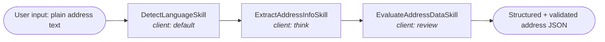
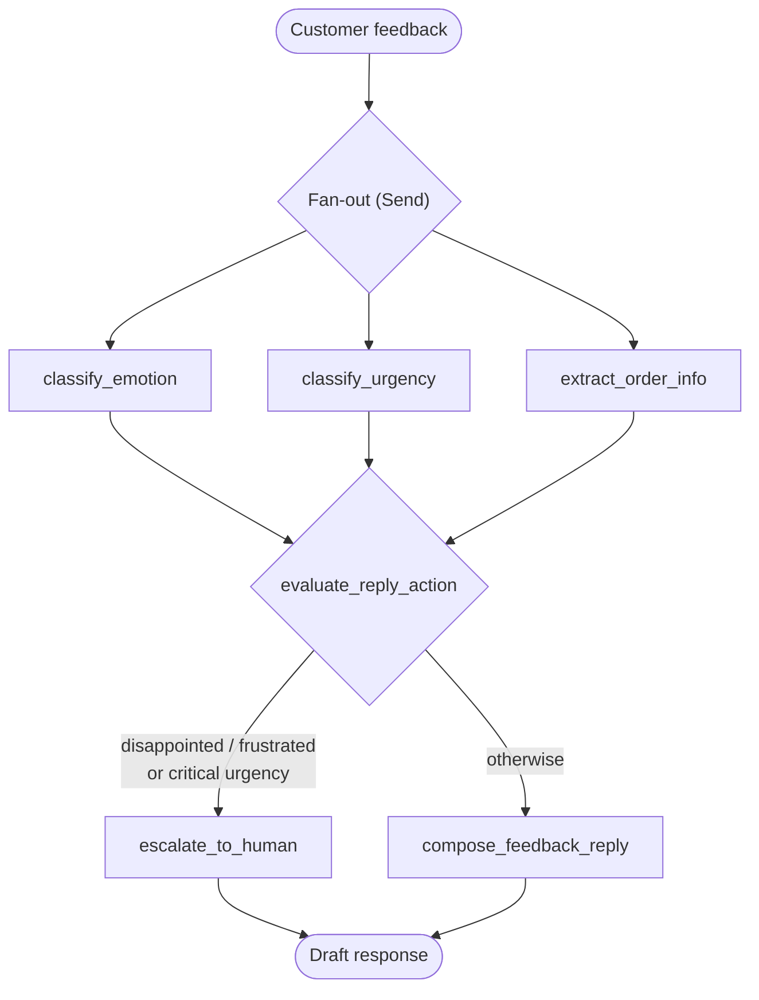
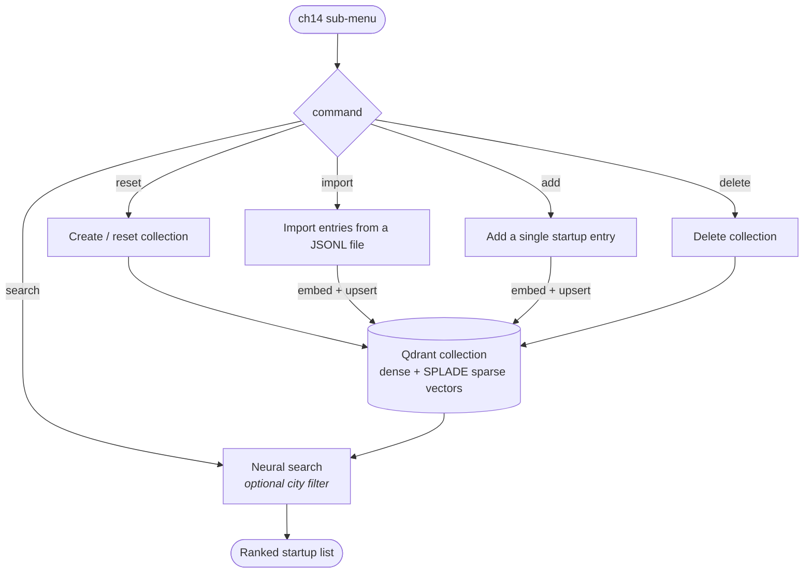

# agentic-pattern-sample

A hands-on sample project for **Agentic Design Patterns**, running entirely on local LLMs via [Ollama](https://ollama.com/). Each chapter implements one classic agent pattern as a runnable demo.

## About the book

[*Agentic Design Patterns: A Hands-On Guide to Building Intelligent Systems*](https://link.springer.com/book/10.1007/978-3-032-01402-3) by Antonio Gullì (Springer Nature, 2025) catalogs 21 design patterns for building AI agents, one chapter per pattern. Much like design patterns in software engineering, these patterns are reusable, battle-tested solutions to common challenges in agent design — from foundational workflow patterns (Prompt Chaining, Routing, Parallelization, Reflection, Tool Use, Planning, Multi-Agent Collaboration) to production concerns (Memory Management, Human-in-the-Loop, Knowledge Retrieval / RAG, Guardrails, Evaluation and Monitoring).

Each chapter follows the same template: a pattern overview, practical applications and use cases, hands-on code examples, and key takeaways. The book's examples use LangChain/LangGraph, CrewAI, and Google ADK; this repository re-implements selected patterns with plain Python protocols and local models, so every demo runs without cloud API keys. Chapter numbers below refer to the book.

## Demos

| Chapter | Pattern             | Scenario                                                                                                                                                                                            |
|---------|---------------------|-----------------------------------------------------------------------------------------------------------------------------------------------------------------------------------------------------|
| ch01    | Prompt Chaining     | Address info parser: detect language → extract address into JSON → validate the address data. Each subtask can be handled by a different LLM.                                                       |
| ch02    | Routing             | Customer support chatbot: classify the customer's intent (pre-sale / post-sale / business cooperation / unknown) and route it to the matching skill to generate a reply.                            |
| ch03    | Parallelization     | Customer feedback analyst: classify emotion, classify urgency, and extract order info in parallel, then auto-compose a reply or escalate to human support (orchestrated with a LangGraph workflow). |
| ch14    | Knowledge Retrieval | Startup knowledge base on Qdrant: create/reset a collection, import entries, add entries, and run hybrid neural search (dense vectors + SPLADE sparse vectors, with optional city filter).          |

### ch01: Prompt Chaining

Each subtask runs in sequence and can be bound to a different LLM client (`default` / `think` / `review`):



### ch02: Routing

A classifier detects the intent, then the request is routed to the matching reply skill:


### ch03: Parallelization

A LangGraph workflow fans out to three parallel nodes, then converges to decide the reply action:



### ch14: Knowledge Retrieval

A menu-driven agent manages a startup knowledge base in Qdrant. Entries are embedded with a local embedding model (`bge-m3` by default) and searched with hybrid dense + sparse retrieval:



## Architecture

```text
src/glab/
├── app_main.py                  # CLI entry point (the `start` command)
├── config.py                    # Settings (pydantic-settings, reads .env)
├── app/                         # CLI applications per chapter (input collection → agent run)
│   ├── app_ch01_address_parser.py
│   ├── app_ch02_customer_support.py
│   ├── app_ch03_customer_feedback.py
│   └── app_ch14_startup_retrieval.py
├── agents/                      # Agent implementations per chapter
│   ├── agent_ch01_address_parser.py
│   ├── agent_ch02_customer_support.py
│   ├── agent_ch03_feedback_analyst.py
│   └── agent_ch14_startup_retrieval.py
├── comm/
│   ├── library.py               # Core abstractions: Application / Agent / Skill / LlmClient / VdbClient protocols, AgentBuilder
│   ├── skills.py                # Reusable skills (prompt template rendering, JSON parsing)
│   ├── llm_client_ollama.py     # Ollama client (chat / embed)
│   ├── llm_client_langchain.py  # LangChain-wrapped LLM client (with tool calling)
│   ├── graph_maker_langgraph.py # LangGraph workflow wrapper
│   └── vdb_client_qdrant.py     # Qdrant vector DB client (dense + sparse hybrid search)
└── prompts/                     # Prompt templates (Markdown)
```

### Core design

The code is organized in three layers, connected by protocols defined in `comm/library.py`:

- **Application** (`app/`) — the CLI layer. An `Application` collects user input (`collect_input`), hands it to an agent (`process`), and the entry point in `app_main.py` renders the returned `AgentResponse` (result, token usage, full message history).
- **Agent** (`agents/`) — the orchestration layer. An `Agent` implements one design pattern: it sequences, routes, or parallelizes `Skill` calls (a `Skill` renders a prompt from the templates in `prompts/`), or drives a workflow via LangGraph (`GraphMaker`). Every run produces an `AgentResponse` aggregating all messages, raw LLM responses, and total token usage.
- **Clients** (`comm/`) — the pluggable infrastructure layer. `LlmClient` (chat / embed) and `VdbClient` (collection management, import, add, neural search) are protocols with Ollama, LangChain, and Qdrant implementations.

Models are injected by name through `AgentBuilder`: different subtasks (`default` / `think` / `review` / `detect` / ...) can be bound to different models, so a single agent can mix a fast model for classification with a stronger model for reasoning.

## Requirements

- Python ≥ 3.13
- **Ollama** (required) — runs the local LLMs used by all demos (default `http://localhost:11434`):
  1. Install: download from <https://ollama.com/download>, or on macOS run `brew install ollama`
  2. Start the service: `ollama serve` (the desktop app starts it automatically)
  3. Pull the models used by the demos:
     ```bash
     ollama pull ornith-1.5:9b   # chat model (configurable via MYAPP_MODEL)
     ollama pull bge-m3:567m     # embedding model for ch14 (configurable via MYAPP_EMBED_MODEL)
     ```
- **Qdrant** (required for the ch14 demo) — vector database (default `http://localhost:6333`):
  1. The quickest way is Docker (install [Docker](https://docs.docker.com/get-docker/) first):
     ```bash
     docker run -p 6333:6333 -p 6334:6334 qdrant/qdrant
     ```
  2. Other installation options: <https://qdrant.tech/documentation/quickstart/>

## Installation

```bash
python -m venv .venv && source .venv/bin/activate && pip install -e .
```

## Configuration

Create a `.env` file in the project root (environment variables use the `MYAPP_` prefix):

```dotenv
MYAPP_OLLAMA_HOST=http://localhost:11434
MYAPP_QDRANT_HOST=http://localhost:6333
MYAPP_QDRANT_VECTOR_SIZE=1024
MYAPP_MODEL=ornith-1.5:9b
MYAPP_EMBED_MODEL=bge-m3:567m
MYAPP_DEBUG=false
```

All settings are optional; defaults from `config.py` are used when omitted.

## Run

```bash
start
```

This launches an interactive menu. Pick a chapter demo, enter your text (finish with a blank line), and inspect the result, token usage, and the full LLM message history.

Option `14` (Startup Retrieval) opens a sub-menu: after entering a collection name, you can create/reset the collection, import entries from a JSONL file (e.g. `./tests/resource/startups_sample100`), add a single entry, run a neural search, or delete the collection.

## Testing

Tests marked `llm` / `ollama` / `qdrant` require the corresponding local services to be running, and the models they use must be pulled into Ollama first:

```bash
ollama pull ornith-1.5:9b   # default model used by tests (configurable via MYAPP_MODEL)
ollama pull bge-m3:567m     # embedding model used by the Qdrant retrieval tests (configurable via MYAPP_EMBED_MODEL)
```

```bash
pytest                     # run all tests
pytest -m "not llm"        # skip tests that require an LLM service
pytest -m "not ollama"     # skip tests that require the Ollama server
pytest -m "not qdrant"     # skip tests that require the Qdrant server
```

## Tips

- The Qdrant tests (`tests/comm/test_vdb_client_qdrant.py`, `tests/agents/test_agent_ch14_startup_retrieval.py`) import startup data from the bundled sample file `tests/resource/startups_sample100` (JSONL, one startup per line). The full dataset can be downloaded from [startups-list.com](https://startups-list.com/cities) or via the [Qdrant neural-search tutorial](https://qdrant.tech/documentation/tutorials-develop/neural-search/#prepare-sample-dataset).

## License

[MIT](LICENSE) © 2026 GAVIN Lab
