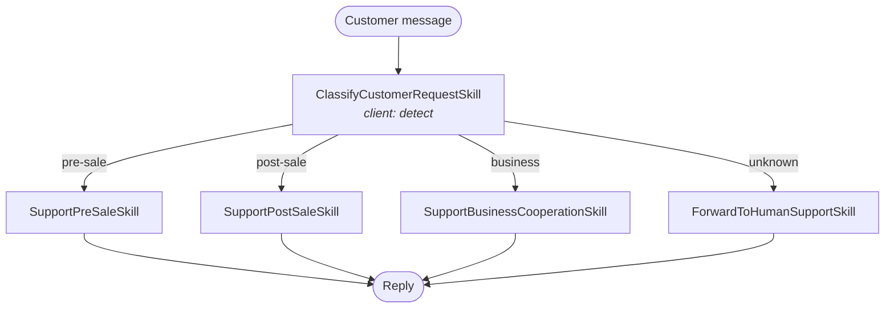

# agentic-pattern-sample

A hands-on sample project for **Agentic Design Patterns**, running entirely on local LLMs via [Ollama](https://ollama.com/). Each chapter implements one classic agent pattern as a runnable demo.

## Demos

| Chapter | Pattern             | Scenario                                                                                                                                                                                            |
|---------|---------------------|-----------------------------------------------------------------------------------------------------------------------------------------------------------------------------------------------------|
| ch01    | Prompt Chaining     | Address info parser: detect language → extract address into JSON → validate the address data. Each subtask can be handled by a different LLM.                                                       |
| ch02    | Routing             | Customer support chatbot: classify the customer's intent (pre-sale / post-sale / business cooperation / unknown) and route it to the matching skill to generate a reply.                            |
| ch03    | Parallelization     | Customer feedback analyst: classify emotion, classify urgency, and extract order info in parallel, then auto-compose a reply or escalate to human support (orchestrated with a LangGraph workflow). |
| ch14    | Knowledge Retrieval | Startup retrieval (planned), backed by Qdrant hybrid search (dense vectors + SPLADE sparse vectors).                                                                                                |

### ch01: Prompt Chaining

Each subtask runs in sequence and can be bound to a different LLM client (`default` / `think` / `review`):


### ch02: Routing

A classifier detects the intent, then the request is routed to the matching reply skill:



### ch03: Parallelization

A LangGraph workflow fans out to three parallel nodes, then converges to decide the reply action:


## Architecture

```text
src/glab/
├── app_main.py                  # CLI entry point (the `start` command)
├── config.py                    # Settings (pydantic-settings, reads .env)
├── agents/                      # Agent implementations per chapter
│   ├── agent_ch01_address_parser.py
│   ├── agent_ch02_customer_support.py
│   └── agent_ch03_feedback_analyst.py
├── comm/
│   ├── library.py               # Core abstractions: Agent / Skill / LlmClient / VdbClient protocols, AgentBuilder
│   ├── skills.py                # Reusable skills (prompt template rendering, JSON parsing)
│   ├── llm_client_ollama.py     # Ollama client (chat / embed)
│   ├── llm_client_langchain.py  # LangChain-wrapped LLM client (with tool calling)
│   ├── graph_maker_langgraph.py # LangGraph workflow wrapper
│   └── vdb_client_qdrant.py     # Qdrant vector DB client (dense + sparse hybrid search)
└── prompts/                     # Prompt templates (Markdown)
```

Core design: an `Agent` is composed of `Skill`s, each responsible for rendering a prompt. `LlmClient` is a pluggable protocol, so different subtasks (`default` / `think` / `review` / ...) can be bound to different models and injected via `AgentBuilder`.

## Requirements

- Python ≥ 3.13
- **Ollama** (required) — runs the local LLMs used by all demos (default `http://localhost:11434`):
  1. Install: download from <https://ollama.com/download>, or on macOS run `brew install ollama`
  2. Start the service: `ollama serve` (the desktop app starts it automatically)
  3. Pull the demo model:
     ```bash
     ollama pull ornith-1.5:9b
     ```
- **Qdrant** (optional) — vector database, only needed for knowledge-retrieval features (default `http://localhost:6333`):
  1. The quickest way is Docker (install [Docker](https://docs.docker.com/get-docker/) first):
     ```bash
     docker run -p 6333:6333 -p 6334:6334 qdrant/qdrant
     ```
  2. Other installation options: <https://qdrant.tech/documentation/quickstart/>

## Installation

```bash
python -m venv .venv && source .venv/bin/activate && pip install -e .
```

## Configuration

Create a `.env` file in the project root (environment variables use the `MYAPP_` prefix):

```dotenv
MYAPP_OLLAMA_HOST=http://localhost:11434
MYAPP_QDRANT_HOST=http://localhost:6333
MYAPP_QDRANT_VECTOR_SIZE=1024
MYAPP_MODEL=ornith-1.5:9b
MYAPP_DEBUG=false
```

All settings are optional; defaults from `config.py` are used when omitted.

## Run

```bash
start
```

This launches an interactive menu. Pick a chapter demo, enter your text (finish with a blank line), and inspect the result, token usage, and the full LLM message history.

## Testing

Tests marked `llm` / `ollama` / `qdrant` require the corresponding local services to be running, and the models they use must be pulled into Ollama first:

```bash
ollama pull ornith-1.5:9b   # default model used by tests (configurable via MYAPP_MODEL)
ollama pull bge-m3:567m     # embedding model used by the Qdrant retrieval test
```

```bash
pytest                     # run all tests
pytest -m "not llm"        # skip tests that require an LLM service
pytest -m "not ollama"     # skip tests that require the Ollama server
pytest -m "not qdrant"     # skip tests that require the Qdrant server
```
## Tips

- The Qdrant test (`tests/comm/test_vdb_client_qdrant.py`) imports startup data from the bundled sample file `tests/resource/startups_demo` (JSONL, one startup per line). The full dataset can be downloaded from [startups-list.com](https://startups-list.com/cities) or via the [Qdrant neural-search tutorial](https://qdrant.tech/documentation/tutorials-develop/neural-search/#prepare-sample-dataset).

## License

[MIT](LICENSE) © 2026 GAVIN Lab
