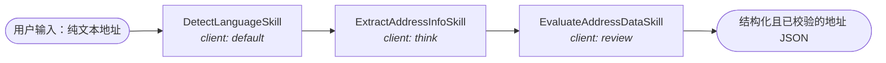
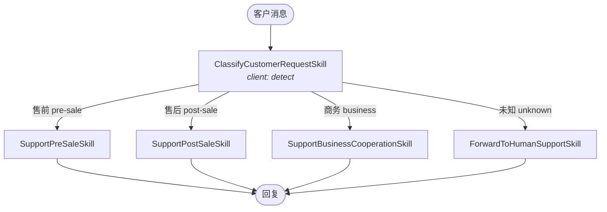
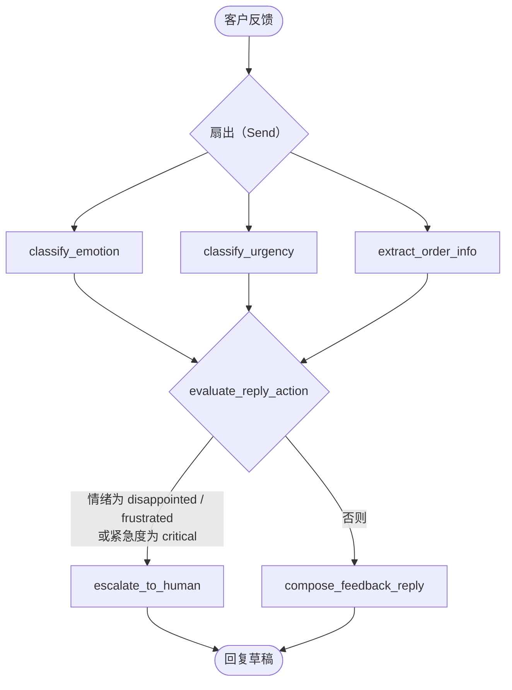
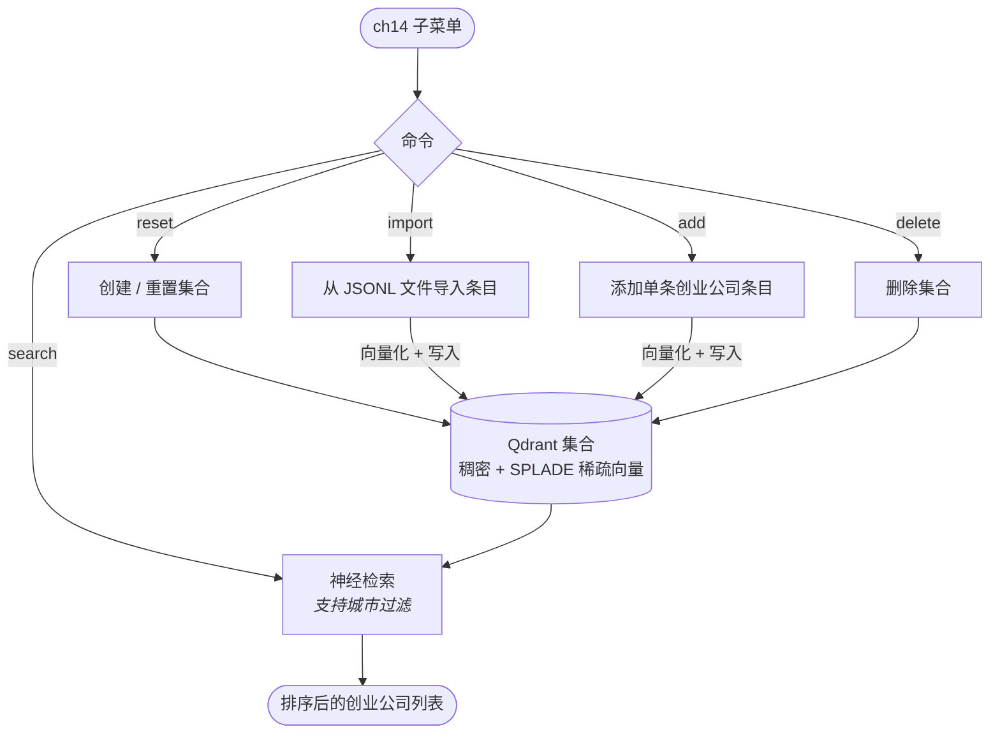

# agentic-pattern-sample

**Agentic Design Patterns（智能体设计模式）** 的动手实践示例项目，完全基于本地 LLM（通过 [Ollama](https://ollama.com/)）运行。每个章节用一个可运行的演示实现一种经典的智能体设计模式。

## 关于本书

[*Agentic Design Patterns: A Hands-On Guide to Building Intelligent Systems*](https://link.springer.com/book/10.1007/978-3-032-01402-3) 由 Antonio Gullì 撰写（Springer Nature，2025），归纳了构建 AI 智能体的 21 种设计模式，每章讲解一种。正如软件工程中的设计模式，这些模式是针对智能体设计中常见问题的可复用、经过实践检验的解决方案——从基础的工作流模式（提示链、路由、并行化、反思、工具调用、规划、多智能体协作），到生产环境关注点（记忆管理、人在环路、知识检索 / RAG、护栏、评估与监控）。

每章采用统一的结构：模式概述、实际应用与用例、动手代码示例、要点总结。原书示例使用 LangChain/LangGraph、CrewAI 和 Google ADK 三个框架；本仓库用纯 Python 协议和本地模型重新实现了其中的部分模式，所有演示都无需云端 API key 即可运行。下文章节编号与原书对应。

## 演示内容

| 章节 | 模式       | 场景                                                                                                                                  |
|------|-----------|--------------------------------------------------------------------------------------------------------------------------------------|
| ch01 | 提示链（Prompt Chaining） | 地址信息解析：检测语言 → 抽取地址为 JSON → 校验地址数据。每个子任务可由不同的 LLM 处理。                                              |
| ch02 | 路由（Routing）          | 客服机器人：识别客户意图（售前 / 售后 / 商务合作 / 未知），路由到对应的技能生成回复。                                                  |
| ch03 | 并行化（Parallelization） | 客户反馈分析：并行执行情绪分类、紧急度分类、订单信息抽取，然后自动生成回复或转人工（基于 LangGraph 工作流编排）。                      |
| ch14 | 知识检索（Knowledge Retrieval） | 基于 Qdrant 的创业公司知识库：创建/重置集合、导入条目、添加条目，以及混合神经检索（稠密向量 + SPLADE 稀疏向量，支持按城市过滤）。       |

### ch01：提示链

各子任务按顺序执行，可分别绑定不同的 LLM 客户端（`default` / `think` / `review`）：



### ch02：路由

分类器先识别意图，再将请求路由到对应的回复技能：



### ch03：并行化

LangGraph 工作流先扇出到三个并行节点，再汇聚以决定回复动作：



### ch14：知识检索

菜单驱动的智能体，管理 Qdrant 中的创业公司知识库。条目使用本地嵌入模型（默认 `bge-m3`）向量化，检索采用稠密 + 稀疏混合方式：



## 架构

```text
src/glab/
├── app_main.py                  # CLI 入口（start 命令）
├── config.py                    # 配置（pydantic-settings，读取 .env）
├── app/                         # 各章节的 CLI 应用（收集输入 → 运行智能体）
│   ├── app_ch01_address_parser.py
│   ├── app_ch02_customer_support.py
│   ├── app_ch03_customer_feedback.py
│   └── app_ch14_startup_retrieval.py
├── agents/                      # 各章节的智能体实现
│   ├── agent_ch01_address_parser.py
│   ├── agent_ch02_customer_support.py
│   ├── agent_ch03_feedback_analyst.py
│   └── agent_ch14_startup_retrieval.py
├── comm/
│   ├── library.py               # 核心抽象：Application / Agent / Skill / LlmClient / VdbClient 协议、AgentBuilder
│   ├── skills.py                # 可复用技能（提示词模板渲染、JSON 解析）
│   ├── llm_client_ollama.py     # Ollama 客户端（chat / embed）
│   ├── llm_client_langchain.py  # LangChain 封装的 LLM 客户端（支持工具调用）
│   ├── graph_maker_langgraph.py # LangGraph 工作流封装
│   └── vdb_client_qdrant.py     # Qdrant 向量库客户端（稠密 + 稀疏混合检索）
└── prompts/                     # 提示词模板（Markdown）
```

### 核心设计

代码分为三层，通过 `comm/library.py` 中定义的协议连接：

- **Application（`app/`）**——CLI 层。`Application` 负责收集用户输入（`collect_input`），交给智能体处理（`process`），入口 `app_main.py` 负责渲染返回的 `AgentResponse`（结果、Token 用量、完整消息历史）。
- **Agent（`agents/`）**——编排层。每个 `Agent` 实现一种设计模式：对 `Skill` 调用进行顺序编排、路由或并行（`Skill` 负责从 `prompts/` 的模板渲染提示词），或通过 `GraphMaker` 驱动 LangGraph 工作流。每次运行都产出一个 `AgentResponse`，聚合全部消息、原始 LLM 响应和总 Token 用量。
- **Clients（`comm/`）**——可插拔的基础设施层。`LlmClient`（chat / embed）和 `VdbClient`（集合管理、导入、添加、神经检索）都是协议，分别提供 Ollama、LangChain 和 Qdrant 实现。

模型通过 `AgentBuilder` 按名字注入：不同的子任务（`default` / `think` / `review` / `detect` 等）可绑定不同的模型，因此一个智能体可以混用快速模型（做分类）和强模型（做推理）。

## 环境要求

- Python ≥ 3.13
- **Ollama**（必需）——运行所有演示所用的本地 LLM（默认 `http://localhost:11434`）：
  1. 安装：从 <https://ollama.com/download> 下载，macOS 也可以运行 `brew install ollama`
  2. 启动服务：`ollama serve`（桌面应用会自动启动）
  3. 拉取演示所用的模型：
     ```bash
     ollama pull ornith-1.5:9b   # 对话模型（可通过 MYAPP_MODEL 配置）
     ollama pull bge-m3:567m     # ch14 的嵌入模型（可通过 MYAPP_EMBED_MODEL 配置）
     ```
- **Qdrant**（ch14 演示需要）——向量数据库（默认 `http://localhost:6333`）：
  1. 最快的方式是 Docker（需先安装 [Docker](https://docs.docker.com/get-docker/)）：
     ```bash
     docker run -p 6333:6333 -p 6334:6334 qdrant/qdrant
     ```
  2. 其他安装方式：<https://qdrant.tech/documentation/quickstart/>

## 安装

```bash
python -m venv .venv && source .venv/bin/activate && pip install -e .
```

## 配置

在项目根目录创建 `.env` 文件（环境变量前缀为 `MYAPP_`）：

```dotenv
MYAPP_OLLAMA_HOST=http://localhost:11434
MYAPP_QDRANT_HOST=http://localhost:6333
MYAPP_QDRANT_VECTOR_SIZE=1024
MYAPP_MODEL=ornith-1.5:9b
MYAPP_EMBED_MODEL=bge-m3:567m
MYAPP_DEBUG=false
```

所有配置均为可选，缺省时使用 `config.py` 中的默认值。

## 运行

```bash
start
```

启动交互式菜单。选择章节演示，输入文本（空行结束输入），即可查看处理结果、Token 用量和完整的 LLM 消息历史。

选项 `14`（Startup Retrieval）会进入子菜单：输入集合名称后，可以创建/重置集合、从 JSONL 文件导入条目（例如 `./tests/resource/startups_sample100`）、添加单条条目、执行神经检索或删除集合。

## 测试

标记为 `llm` / `ollama` / `qdrant` 的测试需要对应的本地服务已启动，且所用模型已拉取到 Ollama：

```bash
ollama pull ornith-1.5:9b   # 测试默认使用的模型（可通过 MYAPP_MODEL 配置）
ollama pull bge-m3:567m     # Qdrant 检索测试使用的嵌入模型（可通过 MYAPP_EMBED_MODEL 配置）
```

```bash
pytest                     # 运行全部测试
pytest -m "not llm"        # 跳过需要 LLM 服务的测试
pytest -m "not ollama"     # 跳过需要 Ollama 服务的测试
pytest -m "not qdrant"     # 跳过需要 Qdrant 服务的测试
```

## 提示

- Qdrant 测试（`tests/comm/test_vdb_client_qdrant.py`、`tests/agents/test_agent_ch14_startup_retrieval.py`）从仓库自带的示例文件 `tests/resource/startups_sample100`（JSONL 格式，每行一条创业公司记录）导入数据。完整数据集可从 [startups-list.com](https://startups-list.com/cities) 或 [Qdrant 神经检索教程](https://qdrant.tech/documentation/tutorials-develop/neural-search/#prepare-sample-dataset) 下载。

## 许可证

[MIT](LICENSE) © 2026 GAVIN Lab
